<div align="center">



<p align="center">
  
</p>

<p align="center">
  
  
  
</p>



</div>

---

### // THE WEAVER: WHOAMI

```bash
$ cat /etc/passwd | grep nour0704
user@web:~$ whoami --verbose
> IDENTITY  : Nour Hammemi // [GitHub: nour0704]
> ROLE      : 4th-Year Engineering Student (Cybersecurity & Cloud) @ ESPRIT
> FOCUS     : Mobile Apps, Java Backends & AI Services
> STATUS    : weaving...
```

<div align="center"></div>

### // THE WEB: TECH STACK

<div align="center">
  
</div>

| Domain | Stack / Environment |
| :--- | :--- |
| **Mobile** | `Expo` • `React Native` • `TypeScript` • `Tailwind CSS` |
| **Backend** | `Java` • `Maven` |
| **AI** | `Python` |
| **Specialty** | `Cybersecurity` • `Cloud Engineering` |

<!-- Add anything else you use here: databases, DevOps tools, cloud providers, etc. -->

<p align="center">
  
  
  
  
  
  
</p>

<div align="center"></div>

### // THE CATCH: PROJECTS

```bash
$ ls -la /web/captured/
```

* 📱 [**`nour0704/megappfrontend`**](https://github.com/nour0704/megappfrontend) — TypeScript • Expo / React Native mobile app front end.
* ☕ [**`nour0704/megappbackend`**](https://github.com/nour0704/megappbackend) — Java • Maven backend service.
* 🧠 [**`nour0704/megappAIsection`**](https://github.com/nour0704/megappAIsection) — Python • the AI section of the project.
* 🕸️ [**`nour0704/SuperTounsi-integrated-version-`**](https://github.com/nour0704/SuperTounsi-integrated-version-) — Integrated version of the SuperTounsi project.
* 📦 [**`nour0704/Autoloc`**](https://github.com/nour0704/Autoloc) — Java project.

<div align="center"></div>

### // TELEMETRY: WHAT THE WEB CAUGHT

<div align="center">
  
  
</div>

---

<div align="center">
  
</div>
